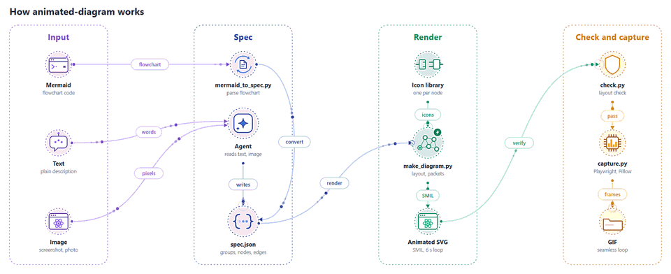

<h1 align="center">animated-diagram</h1>

<p align="center">
  구조도를 움직이는 GIF/SVG로 만드는 에이전트 스킬입니다.<br>
  노드마다 직접 그린 아이콘이 각자의 마이크로 인터랙션으로 움직이고, 연결선을 따라 데이터 패킷이 흐릅니다.
</p>

<p align="center">
  <picture>
    <source media="(prefers-color-scheme: dark)" srcset="assets/how-it-works-dark.gif">
    
  </picture>
</p>

<p align="center">
  <a href="LICENSE"></a>
  <a href="pyproject.toml"></a>
  <a href="https://agentskills.io"></a>
  <a href="README.md"></a>
</p>

## 기능

- **세 가지 입력**: Mermaid 플로우차트, 텍스트 설명, 구조도 이미지(스크린샷, 사진, 화이트보드).
- **움직이는 아이콘**: 노드마다 각자의 동작을 가진 아이콘이 붙습니다. 맞는 아이콘이 없으면 에이전트가 같은 스타일로 그립니다.
- **흐르는 데이터 패킷**: 패킷이 데이터 방향을 따라 연결선 위를 이동합니다.
- **두 가지 선 표시 방식**: 처음부터 선이 보이거나, 선이 스스로 그려지고 6초마다 반복됩니다.
- **라이트/다크 테마**: 하나만 만들거나, 둘 다 만들어 README가 뷰어의 모드에 맞춰 바뀌게 할 수 있습니다.
- **전달 전 검사**: GIF를 캡처하기 전에 선 교차, 잘린 라벨, 노드 위를 지나는 선을 레이아웃 검사로 찾아냅니다.

## 동작 방식

위 애니메이션이 바로 이 파이프라인이며, 이 스킬이 [`assets/how-it-works.json`](assets/how-it-works.json)으로 그린 것입니다.

1. **스펙.** `mermaid_to_spec.py`가 Mermaid 플로우차트를 변환합니다. 텍스트나 이미지는 에이전트가 그룹(열), 노드,
   엣지로 된 `spec.json`을 직접 작성합니다.
2. **렌더.** `make_diagram.py`가 그룹을 열로 배치하고 노드마다 아이콘을 붙여, 6초마다 반복되는 움직이는
   SVG(SMIL)를 만듭니다.
3. **검사.** `check.py`는 잘린 라벨, 노드 위를 지나는 선, 자체 동작이 없는 아이콘을 실패로 처리합니다. 선
   교차는 경고만 합니다.
4. **캡처.** `capture.py`가 헤드리스 브라우저에서 SVG를 프레임 단위로 재생하고 Pillow로 GIF를 만듭니다.
   ffmpeg가 필요 없고 프레임이 빠지지 않습니다. 노드 6~11개 기준 0.7~1.3MB입니다.

스크립트는 [`skills/animated-diagram/scripts`](skills/animated-diagram/scripts)에 있습니다.

## 설치

코딩 에이전트(Claude Code, Codex, Cursor 등 [Agent Skills](https://agentskills.io)를 지원하는 에이전트)에
아래 문장을 붙여 넣으세요.

```text
Read https://raw.githubusercontent.com/Ludobico/animated-diagram/main/INSTALL.md and follow it to install the animated-diagram skill.
```

에이전트가 저장소를 내려받고, 스킬 폴더에 연결한 뒤, 동작 확인까지 합니다. [INSTALL.md](INSTALL.md)는
일반 마크다운이라 무엇을 할지 미리 읽어 볼 수 있습니다.

<details>
<summary>직접 설치 (Claude Code, Codex)</summary>

먼저 한 번 내려받습니다.

```bash
git clone --depth 1 https://github.com/Ludobico/animated-diagram.git ~/.animated-diagram
```

**Claude Code**

```bash
ln -s ~/.animated-diagram/skills/animated-diagram ~/.claude/skills/animated-diagram
```

Windows(PowerShell):

```powershell
New-Item -ItemType Junction -Path "$HOME\.claude\skills\animated-diagram" -Target "$HOME\.animated-diagram\skills\animated-diagram"
```

**Codex**

```bash
mkdir -p ~/.codex/skills
ln -s ~/.animated-diagram/skills/animated-diagram ~/.codex/skills/animated-diagram
```

Windows(PowerShell):

```powershell
New-Item -ItemType Directory -Force "$HOME\.codex\skills" | Out-Null
New-Item -ItemType Junction -Path "$HOME\.codex\skills\animated-diagram" -Target "$HOME\.animated-diagram\skills\animated-diagram"
```

한 프로젝트에서만 쓰려면 대신 `<프로젝트>/.agents/skills/`에 연결하세요. Codex는 새 스킬을 자동으로 인식하며,
보이지 않으면 Codex를 다시 시작한 뒤 `$`를 입력하거나 `/skills`를 실행해 찾으세요.

업데이트는 `git -C ~/.animated-diagram pull`입니다.

> [!NOTE]
> Codex 설치 절차는 Windows의 Codex CLI 0.165.0에서 확인했습니다. 스킬이 발견되고, 이름과 설명을 읽고,
> junction을 따라가는 것까지입니다. Codex 모델로 끝까지 실행해 본 것은 아닙니다.

</details>

<details>
<summary>Claude Desktop / claude.ai</summary>

같은 문장을 주면 ZIP을 만들어 줍니다. 그 ZIP을 Customize → Skills에서 업로드하세요.

</details>

> [!NOTE]
> Claude Desktop과 claude.ai에서는 스크립트가 Anthropic 클라우드 샌드박스에서 실행되므로 GIF 없이 움직이는
> SVG만 나올 수 있습니다.

## 사용

에이전트에게 이렇게 요청하세요.

- "이 Mermaid 구조도를 움직이는 GIF로 만들어 줘"
- "이 아키텍처 스크린샷을 다크 테마로 움직이게 해 줘"
- "웹 앱, API 게이트웨이, Redis, Postgres로 된 구조야. 움직이는 구조도로 만들어 줘"

에이전트가 선이 스스로 그려지게 할지, 어떤 테마를 쓸지 한 번 물은 뒤, 스펙 작성, 렌더링, 검사, 캡처까지
진행합니다. 예제는 [`skills/animated-diagram/examples`](skills/animated-diagram/examples)에 있습니다.

### 옵션

| 선택 | 값 | 효과 |
|---|---|---|
| 선 | `static` | 선, 화살표, 라벨이 첫 프레임부터 보입니다. 패킷만 움직입니다. |
| | `draw` | 선이 그려지고 패킷이 흐른 뒤, 선이 사라지며 반복됩니다. |
| 테마 | `light`, `dark` | `dark`는 GitHub 다크 배경을 써서 README에 자연스럽게 섞입니다. |
| | 둘 다 | 둘 다 만들어 README가 뷰어의 모드에 맞춰 바뀌게 합니다(아래 스니펫). |

뷰어의 모드에 맞춰 바꾸려면 GIF 두 개를 이렇게 넣으세요.

```html
<picture>
  <source media="(prefers-color-scheme: dark)" srcset="diagram-dark.gif">
  
</picture>
```

글자를 더 선명하게 하려면 대신 움직이는 SVG를 ``로 넣으세요. 채팅 앱, 이메일, 슬라이드는
SVG의 첫 프레임만 보여 주는 경우가 많으니 GIF도 함께 두세요. `GIF_WIDTH`로 GIF 크기를, `GIF_COLORS`로 팔레트
크기를 바꿀 수 있습니다.

### 아이콘

노드마다 내장 아이콘 중 하나가 라벨에서 골라져 붙습니다(`redis`는 캐시 아이콘, `kafka`는 큐 아이콘 등). 다른
아이콘을 쓰려면 노드에 `"icon"`을 지정하세요. 맞는 게 없으면 에이전트가 같은 스타일로 새 아이콘을 그리며, 그
작업에서만 쓰입니다. 전체 목록은 [`references/icons.md`](skills/animated-diagram/references/icons.md)에 있습니다.

## 한계

- 레이아웃은 항상 그룹당 한 열인 왼쪽→오른쪽 열 배치입니다. 위→아래 Mermaid 다이어그램도 이 방식으로 다시 그립니다.
- 열당 약 7개, 전체 25개 노드, 6열을 넘으면 가독성이 떨어집니다. 더 큰 구조도는 나누세요.
- 열을 건너뛰는 엣지는 사이 열의 노드 위를 지날 수 있고, `check.py`가 이를 실패로 처리합니다. 그룹 순서를
  바꾸거나 구조도를 나누세요.
- 피할 수 없는 교차도 있습니다. 예를 들어 두 출발지가 같은 두 도착지에 모두 연결되는 경우입니다.

> [!WARNING]
> 이미지 입력은 에이전트가 읽으며, 결과를 자동으로 검증하는 장치는 없습니다. 에이전트가 추측한 내용을 목록으로
> 보여 주고 렌더링 전에 확인을 받지만, 노드와 엣지 목록은 직접 확인하세요.

레이아웃과 검증 범위에 대한 자세한 내용: [`references/limits.md`](skills/animated-diagram/references/limits.md).

## 요구 사항

- Python 3.10 이상
- GIF 캡처: Pillow와 Playwright(`uv run`이 둘 다 설치하거나 `pip install pillow playwright`), 그리고 Chrome,
  Edge 또는 `playwright install chromium`

브라우저가 없어도 브라우저와 README에서 재생되는 움직이는 SVG는 만들 수 있습니다.
