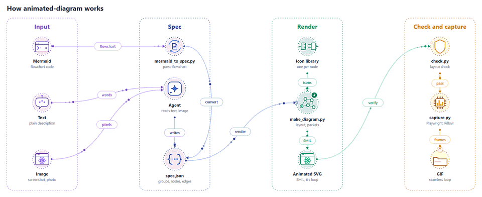
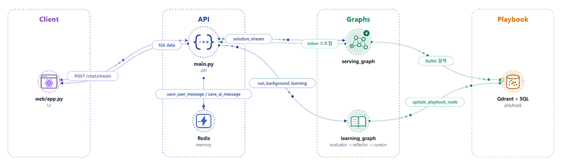
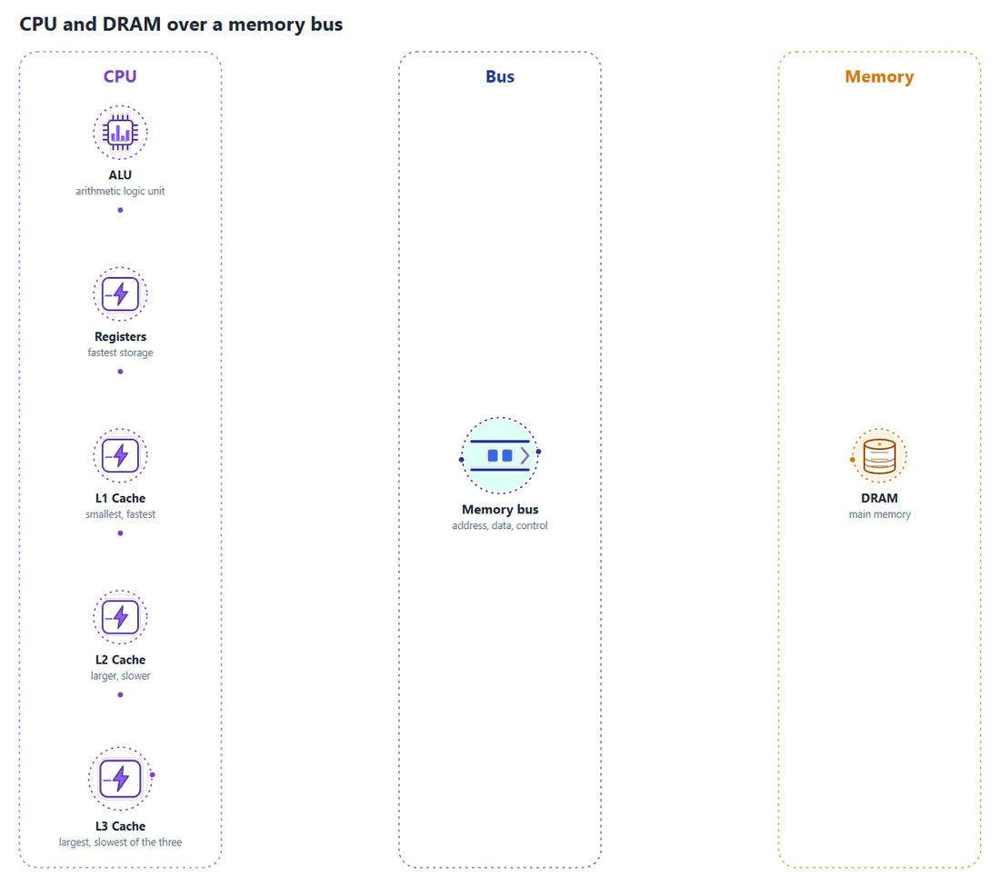
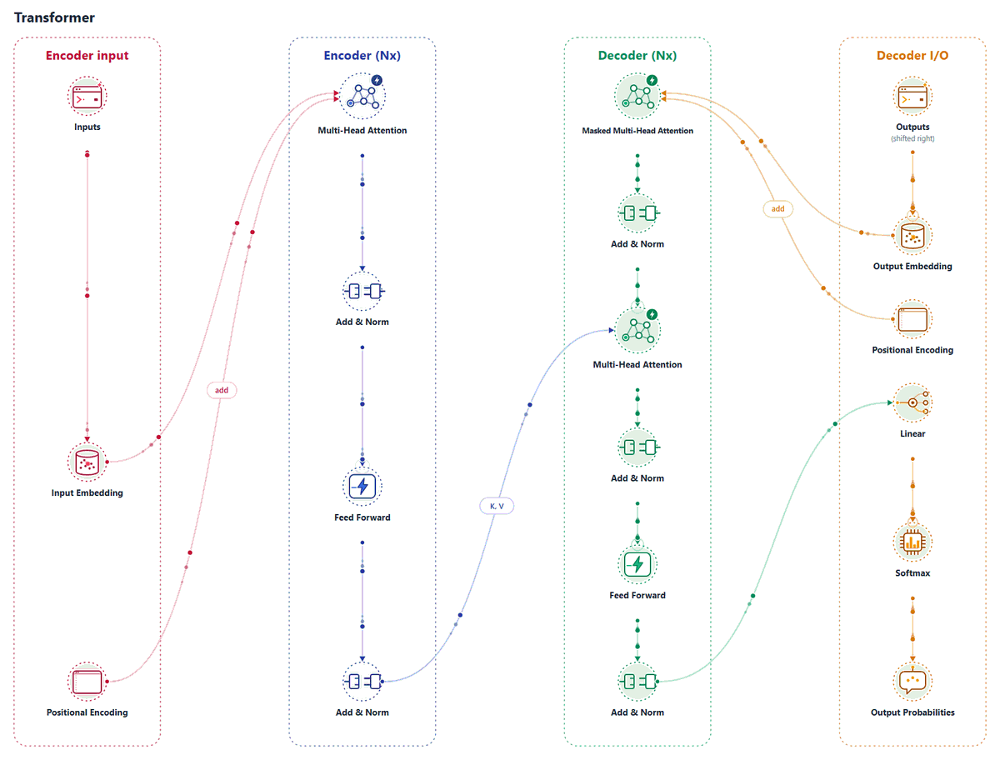

<h1 align="center">animated-diagram</h1>

<p align="center">
  An agent skill that turns an architecture diagram into an animated GIF or SVG.<br>
  Every node gets a hand-drawn icon with its own micro-interaction, and data packets flow along the edges.
</p>

<p align="center">
  <picture>
    <source media="(prefers-color-scheme: dark)" srcset="assets/how-it-works-dark.gif">
    
  </picture>
</p>

<p align="center">
  <a href="LICENSE"></a>
  <a href="pyproject.toml"></a>
  <a href="https://agentskills.io"></a>
  <a href="README.ko.md"></a>
</p>

## Features

- **Three kinds of input**: Mermaid flowcharts, a plain-text description, or an image of a diagram (screenshot, photo, whiteboard).
- **Animated icons**: each node gets an icon with its own motion. If none fits, the agent draws one in the same style.
- **Flowing data packets**: packets travel along the edges, in the direction of the data.
- **Two line styles**: lines visible from the start, or lines that draw themselves and repeat every 6 seconds.
- **Light and dark themes**: render either one, or both and let the README switch with the viewer's mode.
- **Checked before delivery**: a layout check flags crossings, clipped labels and lines over nodes before the GIF is captured.

## How it works

The animation above is the pipeline, drawn by this skill from [`assets/how-it-works.json`](assets/how-it-works.json).

1. **Spec.** `mermaid_to_spec.py` converts a Mermaid flowchart. For text or an image, the agent writes the
   `spec.json` itself: groups (columns), nodes and edges.
2. **Render.** `make_diagram.py` lays the groups out as columns, gives each node an icon, and writes an
   animated SVG (SMIL) that loops every 6 seconds.
3. **Check.** `check.py` fails on clipped labels, lines running over nodes and icons without a motion of
   their own. It only warns on crossings.
4. **Capture.** `capture.py` steps the SVG frame by frame in a headless browser and encodes a GIF with
   Pillow. No ffmpeg, and no frames dropped. Diagrams of 6 to 11 nodes come out at 0.7 to 1.3 MB.

The scripts are in [`skills/animated-diagram/scripts`](skills/animated-diagram/scripts).

> [!NOTE]
> It draws structure, not message order or step-by-step state changes. A sequence diagram is redrawn as
> a flowchart of its participants and messages. Layout limits and what has been verified are in
> [`references/limits.md`](skills/animated-diagram/references/limits.md).

## Install

Paste this into your coding agent (Claude Code, Codex, Cursor and other agents that support
[Agent Skills](https://agentskills.io)):

```text
Read https://raw.githubusercontent.com/Ludobico/animated-diagram/main/INSTALL.md and follow it to install the animated-diagram skill.
```

The agent clones this repository, links the skill into its skills folder, and runs a smoke test.
[INSTALL.md](INSTALL.md) is plain Markdown, so you can read what it will do first.

<details>
<summary>Manual install (Claude Code, Codex)</summary>

Clone once:

```bash
git clone --depth 1 https://github.com/Ludobico/animated-diagram.git ~/.animated-diagram
```

**Claude Code**

```bash
ln -s ~/.animated-diagram/skills/animated-diagram ~/.claude/skills/animated-diagram
```

On Windows (PowerShell):

```powershell
New-Item -ItemType Junction -Path "$HOME\.claude\skills\animated-diagram" -Target "$HOME\.animated-diagram\skills\animated-diagram"
```

**Codex**

```bash
mkdir -p ~/.codex/skills
ln -s ~/.animated-diagram/skills/animated-diagram ~/.codex/skills/animated-diagram
```

On Windows (PowerShell):

```powershell
New-Item -ItemType Directory -Force "$HOME\.codex\skills" | Out-Null
New-Item -ItemType Junction -Path "$HOME\.codex\skills\animated-diagram" -Target "$HOME\.animated-diagram\skills\animated-diagram"
```

For one project only, link into `<project>/.agents/skills/` instead. Codex picks up new skills
automatically; restart it if the skill does not show up, then type `$` or run `/skills` to find it.

Update with `git -C ~/.animated-diagram pull`.

> [!NOTE]
> The Codex steps were checked on Codex CLI 0.165.0 on Windows: the skill is discovered, its name and
> description are read, and the junction is followed. A full run through a Codex model has not been tested.

</details>

<details>
<summary>Claude Desktop / claude.ai</summary>

The same prompt makes a ZIP, which you then upload under Customize → Skills.

</details>

> [!NOTE]
> On Claude Desktop and claude.ai the scripts run in Anthropic's cloud sandbox, so you may get the animated
> SVG without a GIF.

## Usage

Ask your agent, for example:

- "Turn this Mermaid diagram into an animated GIF"
- "Animate this architecture screenshot, dark theme"
- "Here is our service layout: web app, API gateway, Redis, Postgres. Make it an animated diagram"

The agent asks once whether lines should draw themselves and which theme to use, then builds the spec,
renders, checks, and captures. Worked examples are in
[`skills/animated-diagram/examples`](skills/animated-diagram/examples).

### Options

| Choice | Values          | Effect                                                                            |
| ------ | --------------- | --------------------------------------------------------------------------------- |
| Lines  | `static`        | Lines, arrowheads and labels are visible from the first frame. Only packets move. |
|        | `draw`          | Lines draw on, packets flow, then the lines fade out and the loop repeats.        |
| Theme  | `light`, `dark` | `dark` uses GitHub's dark background, so it blends into a README.                 |
|        | both            | Render both and let the README switch with the viewer's mode (snippet below).     |

To switch with the viewer's mode, embed the two GIFs like this:

```html
<picture>
  <source media="(prefers-color-scheme: dark)" srcset="diagram-dark.gif" />
  
</picture>
```

For sharper text, embed the animated SVG with `` instead. Chat apps, email and
slides often show only the first frame of an SVG, so keep the GIF too. Set `GIF_WIDTH` to resize the GIF
and `GIF_COLORS` to change its palette size.

### Icons

Each node gets one of the built-in icons, chosen from its label (`redis` gets the cache icon, `kafka` the
queue, and so on). Set `"icon"` on a node to pick another. If nothing fits, the agent draws a new icon in
the same style for that job only. The full list is in
[`references/icons.md`](skills/animated-diagram/references/icons.md).

## Examples

### From Mermaid

> Turn `examples/mermaid-architecture.mmd` into an animated GIF

([`mermaid-architecture.mmd`](skills/animated-diagram/examples/mermaid-architecture.mmd)).

<details>
<summary>Mermaid input</summary>

```text
flowchart LR
    subgraph Client
        UI["web/app.py<br/>UI"]
    end
    subgraph API
        MAIN["main.py<br/>API"]
        RD[("Redis<br/>memory")]
    end
    subgraph Graphs
        SG[serving_graph]
        LG["learning_graph<br/>evaluator → reflector → curator"]
    end
    subgraph Playbook
        ST[("Qdrant + SQL<br/>playbook")]
    end
    UI -->|POST /chat/stream| MAIN
    MAIN -->|SSE data| UI
    MAIN -->|save_user_message / save_ai_message| RD
    MAIN -->|solution_stream| SG
    SG -->|token 스트림| MAIN
    SG -->|bullet 검색| ST
    MAIN -.->|run_background_learning| LG
    LG -->|update_playbook_node| ST
```

</details>

<p align="center">
  <picture>
    <source media="(prefers-color-scheme: dark)" srcset="assets/example-mermaid-dark.gif">
    
  </picture>
</p>

### From a description

> Draw the structure of a CPU processor with an ALU, registers and L1 to L3 caches, and a diagram of it
> talking to DRAM over a bus. Lines should be absent at first and then connect. Use the light theme.

The prompt names the line style and the theme, so the agent does not ask about them. It only asks about what
the prompt leaves open, here which way the arrows run inside the CPU. They follow the request path outward,
and the bus links run both ways.

<p align="center">
  
</p>

### From an image

> (attach the picture) Turn this diagram into an animated GIF. Light theme, with the lines connected from
> the start.

The input was Figure 1 of [Attention Is All You Need](https://arxiv.org/abs/1706.03762) (Vaswani et al.,
2017). The original figure is not part of this repository. The skill redraws its structure, and it lists what
it read from the picture and what it left out before it renders. Here it left out the residual skip lines,
because the Add & Norm nodes stand for them.

<p align="center">
  
</p>

## Requirements

- Python 3.10+
- To capture GIFs: Pillow and Playwright (`uv run` installs both, or `pip install pillow playwright`), plus
  Chrome, Edge, or `playwright install chromium`

Without a browser, you still get the animated SVG, which plays in browsers and READMEs.
